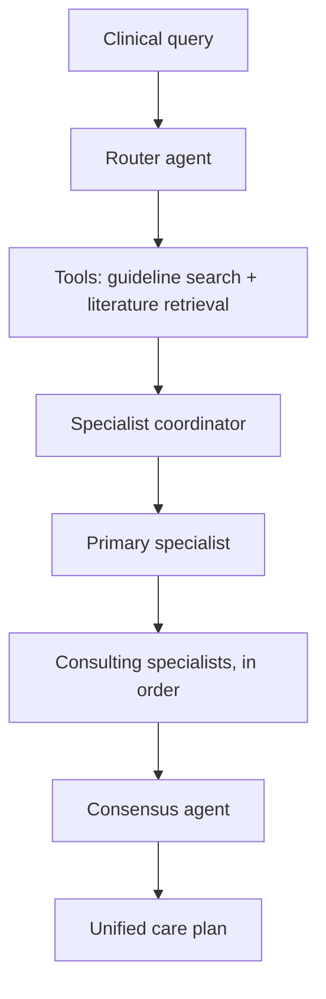

# Cardiometabolic agents

A multi-agent clinical decision support prototype for cardiology, diabetes and hypertension, built with LangGraph and a local LLM (Ollama or vLLM).

> **Not medical advice. Research prototype.** The bundled guideline and literature data are illustrative summaries written for this project, not official guideline text or real publications. Do not use the output for patient care.

## What it does

You type a short clinical case, for example "58yo male, HTN with T2D (A1c 8.5%) and eGFR 55. First-line therapy?". The system then:

1. **Routes** the case. A router agent picks a primary specialist and any additional consults (cardiology, diabetes, hypertension) and sets an urgency level (routine, urgent, emergent).
2. **Gathers evidence.** A tools step searches the local guideline summaries and the literature corpus with the case text.
3. **Runs the specialists in sequence.** The primary specialist goes first; each later specialist sees the earlier specialists' assessments. Each returns structured JSON with an assessment, recommendations, concerns, contraindications, a confidence value and citations.
4. **Builds a consensus.** A consensus agent merges the specialist outputs into one care plan with critical alerts, resolved conflicts, an agreement level and next steps.

The Streamlit app shows each of these stages: the routing decision, one tab per specialist, the consensus plan and the raw tool outputs.

Why this design: multimorbid patients (for example hypertension with type 2 diabetes and CKD) need input from several specialties, and the recommendations can conflict. Splitting the work into routed specialist agents plus an explicit consensus step makes each perspective and each conflict visible instead of hiding them in one long answer.

<!-- screenshot: docs/screenshot.png -->

## Architecture



| Component | File | Role |
|---|---|---|
| Router agent | `agents/router.py` | Picks primary and consulting specialists and urgency; validates and repairs malformed LLM output |
| Specialist agent | `agents/specialist.py` | One class, three domains; extracts age, eGFR and conditions from the query with regex and adds them to the prompt |
| Consensus agent | `agents/consensus.py` | Reconciles specialist outputs into one plan |
| Graph | `graph/builder.py` | LangGraph `StateGraph`: router, tools, specialists, consensus |
| State | `core/state.py` | Typed state shared between nodes |
| LLM client | `core/llm.py` | One interface for Ollama (`/api/chat`) and vLLM (OpenAI-compatible), JSON mode on by default |
| Tools | `tools/` | Guideline search, literature retrieval, dose and interaction stubs, OpenAI-style tool specs |
| JSON parsing | `utils/parser.py` | Tolerant parsing of model output with safe defaults |
| UI | `app.py` | Streamlit front end |

### Tools

| Tool | What it does today |
|---|---|
| `search_guidelines` | Keyword search over the JSON guideline summaries in `data/guidelines/`, filtered by section (diagnosis, treatment, monitoring, drug-dosing) |
| `retrieve_rag` | Keyword search over the JSONL corpus in `data/rag_corpus/`, with title matches weighted higher |
| `calc_dose` | Placeholder: a fixed weight-based formula with a flat reduction when eGFR is below 60. Not a real dosing rule |
| `check_interactions` | Placeholder: returns a fixed example interaction. Not a real interaction database |

### About the data

The seven files in `data/guidelines/` carry the names of real guidelines (ESC, ESH, AHA/ACC, ADA, KDIGO, JNC 8). Their content is a short summary written for this prototype to exercise the pipeline. It is not the official text and has not been checked against it. Each file says so in its `title`, `illustrative` and `disclaimer` fields. The eight entries in `data/rag_corpus/medical_literature.jsonl` are synthetic abstracts and are marked `synthetic` in the same way. `scripts/setup_data.py` regenerates both sets with these labels.

## How to run

Requirements: Python 3.9 or newer and a running Ollama or vLLM server.

```bash
git clone https://github.com/Arjun-Sivasankar/CardioMetabolic-Agents.git
cd CardioMetabolic-Agents
pip install -r requirements.txt

# optional: the data is already committed; this regenerates it
python scripts/setup_data.py
```

Start a model, for example with Ollama:

```bash
ollama pull qwen2.5:1.5b-instruct    # or qwen2.5:7b-instruct
```

Launch the Streamlit app:

```bash
streamlit run app.py
```

In the sidebar choose the provider (`ollama` or `vllm`), model name, endpoint, temperature and max tokens, then click **Apply Configuration**. Without it the app falls back to Ollama with `qwen2.5:1.5b-instruct` at `http://localhost:11434`. The sidebar also has six sample cases. Enter a case and click **Analyze**.

For vLLM, point the endpoint at the OpenAI-compatible base URL, for example `http://localhost:8000/v1`. Defaults live in `config/llm_config.py`.

To run the graph without the UI, `helpers/agentic-langgraph-diagnose.ipynb` is the development notebook.

## Extending it

- **New specialist:** add the domain to the router's allowed list and prompt in `agents/router.py`, register a `SpecialistAgent(llm, "<domain>")` in `graph/builder.py`, add a tab in `app.py`, and add a `data/guidelines/<domain>/` folder.
- **New guideline summary:** add a JSON file with `id`, `title`, `organization`, `year` and `sections` (each with `content` and `key_points`) to the right folder.

## Limitations

- Research prototype. Not validated clinically, not a medical device, not medical advice.
- Guideline and literature data are small illustrative samples, not official sources.
- Retrieval is keyword matching, not embedding search.
- `calc_dose` and `check_interactions` are placeholders that return fixed or formula-based example values.
- Tool calls requested by a specialist are executed, but their results are not yet fed back into that specialist or passed to the consensus step. Only the initial tools step reaches the agents.
- Patient weight is not parsed from the query; a default of 75 kg is used.
- No automated tests or evaluation set yet.
- Quality depends strongly on the model; small models (1.5B) sometimes return malformed JSON, which the parser replaces with safe defaults.

## License

MIT, see [LICENSE](LICENSE).
